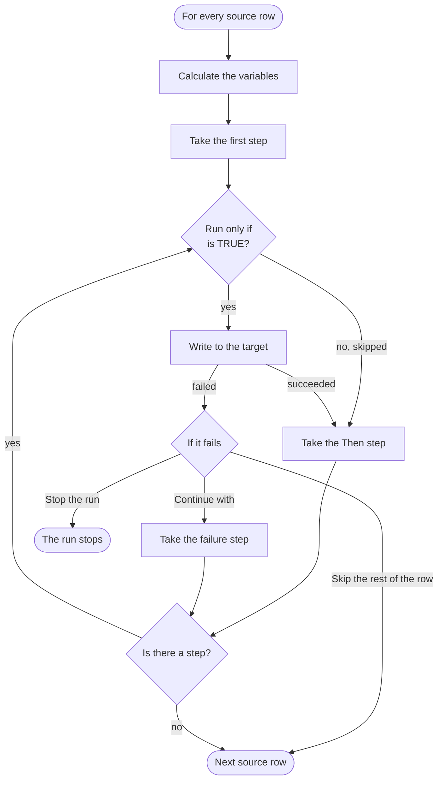

## The parts of a project

A **project** describes one data flow. It is saved as a single file and has these parts:

| Part | What it is |
| --- | --- |
| **Source** | Where the rows come from: a FetchXML query on Dataverse, a SQL query on SQL Server, or a CSV file. A project has exactly one source. |
| **Targets** | The systems written to: a Dataverse table or on-demand workflow, a SQL Server table or stored procedure, or a CSV file. A project can have several targets. Formulas can also *read* from targets with `LOOKUP()`. |
| **Variables** | Optional values calculated once per source row, before the steps run, and used by name in later formulas. |
| **Steps** | What happens for every row: each step writes to one target with one operation. Steps are linked into a chain. |
| **Field mappings** | Per step: which target column (or procedure parameter) gets which value, as a formula. |
| **Match criteria** | Per update, upsert or delete step: which existing records the step works on (*column equals value*). |

## How a run works

For every source row:

1. The **variables** are calculated in their order. A variable that fails marks the row as failed; its steps do not run.
2. The **first step** runs. Exactly one step is marked as the first step.
3. A step with a **Run only if** condition is skipped when the condition is not TRUE. A skipped step counts as succeeded.
4. The step evaluates its mappings and match criteria and writes to its target.
5. After a successful (or skipped) step, the **Then** step runs. After a failed step, **If it fails** decides: *Continue with* another step (or finish the row), *Skip the rest of the row*, or *Stop the run*.
6. The row ends when there is no next step. A step never runs twice for the same row, so links cannot loop.

A row counts as **failed** when any of its steps failed, even when a failure step handled it afterwards. With *List failed rows in the run results* checked (the default), the failure is listed with the row number, the step and the reason.

## Operations

| Operation | What it does | Uses |
| --- | --- | --- |
| **Insert** | Creates one record. | Field mappings |
| **Update** | Updates *every* record matching the criteria. Nothing happens when nothing matches. | Mappings and match criteria |
| **Upsert** | Updates every matching record; inserts one when nothing matches. | Mappings and match criteria |
| **Delete** | Deletes every matching record. | Match criteria |
| **Execute** | Runs a SQL Server stored procedure or a Dataverse on-demand workflow with the mapped parameters. | Field mappings (as parameters) |

Update, upsert and delete always need at least one match criterion, so a forgotten criterion can never change or delete a whole table. CSV targets only support insert.

## Values between steps

Every step makes the values it wrote available to the steps after it, for the same row:

- `V_<step id>_<column>` is the value step *step id* wrote to *column*, for example `V_1_emailaddress1`.
- `V_<step id>_ID` is the id of the record an insert or upsert step created: `table:guid` for Dataverse (usable in lookup columns as is), the identity value for SQL Server.

This is how a second step links records to the record the first step created, for example a contact to the account created just before it.

The values are set even when the write fails, so a failure branch can use them, for example to write the failed row to an error table.

## Dry runs

**Preview** (in the tool) and `replisteer preview` (command line) run the project over the first rows without writing anything. Every formula is evaluated, including lookups, which still read from the targets. The result lists every record that *would* be written, with its values and match criteria.

## Run results

A run ends with one of these statuses:

| Status | Meaning |
| --- | --- |
| Succeeded | Every row was processed without errors. |
| Completed with errors | The run finished, but some rows failed. They are listed in the results. |
| Failed | The run could not start (for example the project is not valid or a connection failed) or a step stopped it. |
| Cancelled | The run was cancelled; rows processed until then stay written. |


Runs are not transactions. Records written before a failure or a cancellation stay written. Use **Preview** first, and prefer upserts matched on a business key so a project can safely be run again.


## Project files

A project is a single file: JSON (`*.replisteer.json`, the default) or XML (`*.replisteer.xml`). It contains every setting described in this documentation. Dataverse credentials are never stored: the file remembers which XrmToolBox connection to use. SQL Server passwords are stored encrypted for your Windows account, or not at all. See [Project files](../../xrmtoolbox/project-files/).
